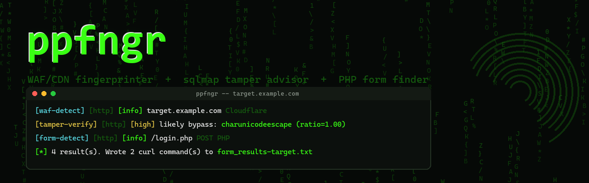

# ppfngr



A WAF/CDN fingerprinter and sqlmap tamper-script advisor, with a built-in
PHP/ASP(X) form finder. Point it at a target and it tells you **what's
protecting it** and **which sqlmap `--tamper` scripts to try first**, then
crawls for forms and hands you ready-to-run `curl` commands for the ones
worth testing.

> For authorized security testing / pentesting / CTF use only.

## What it does

1. **WAF/CDN fingerprinting** — sends a baseline request, then one probe
   per attack category (SQLi, XSS, path traversal, command injection), and
   matches the responses against a hand-written signature set covering
   Cloudflare, Akamai, AWS WAF, Imperva Incapsula, F5 BIG-IP ASM,
   ModSecurity/OWASP CRS, Sucuri, Barracuda, FortiWeb, Citrix NetScaler,
   Wordfence, Azure Front Door, and more.
2. **sqlmap's own WAF/IPS heuristic, reimplemented verbatim** — the same
   "kitchen sink" SQLi+XSS+traversal+RCE payload sqlmap's
   `checkWaf()` sends, diffed against the baseline by similarity ratio.
   Flags interception even when no vendor signature matches.
3. **sqlmap tamper script recommendations** — maps whatever was detected
   to a ranked list of `--tamper` scripts with a one-line reason each,
   plus a ready-to-paste `sqlmap --tamper=...` flag. With `--verify-tampers`,
   it goes further: applies each tamper script for real to an attack
   payload, resends it, and ranks them by how close the response comes
   back to the clean baseline (likely bypass) vs. still looking blocked —
   an actual empirical result instead of a guess by vendor name.
4. **TLS certificate check** — flags a self-signed / hostname-mismatched /
   expired cert as an informational warning (who it's actually issued to,
   who signed it, when it expires) without ever blocking the scan.
5. **PHP/ASP(X) form finder** — crawls the target (same-domain, shallow,
   rate-limited), fingerprints each form's backend language from the
   action extension, response headers, cookies, and framework-specific
   body markers (Laravel/Livewire, ThinkPHP, exposed `composer.json`),
   keeps only PHP and ASP/ASP.NET forms (Java/JSP and JSON/REST API
   endpoints are skipped), and writes each one out as a ready-to-run
   `curl` command. Also prints one overall `[technology]` summary line
   combining every signal already gathered (baseline page, WAF probes,
   crawled forms, composer.json exposure) — `PHP/8.2.34` with the exact
   version when it's exposed, `PHP (unknown version)` when it isn't, same
   for `ASP`/`ASPX`. Says nothing at all for Java/API/anything else.
6. **Multi-target mode, concurrent and RAM-conscious** — pipe a list of
   targets (e.g. a subdomain list) on stdin instead of passing one on the
   command line. Built on asyncio: several targets are scanned at once
   instead of one at a time, with each target's output still printed as
   one clean, non-interleaved block in submission order. How many run at
   once is sized automatically from ~25% of available system RAM (override
   with `--concurrency`), and a live memory watcher pauses *starting* new
   target scans (never kills ones already running) if system memory climbs
   past a safety ceiling during a long run. Keeps going past unreachable
   targets instead of aborting the batch, and writes an aggregate report
   when it's done — plain text by default, or JSON with `--json`.
7. **Optional extras** — a bounded rate-limit probe to catch edge/CDN
   throttling, routing through Tor (with a higher default timeout, since
   Tor circuits add real latency), and a random browser User-Agent.

## Install

### Option A: `uv tool install` (recommended — installs `ppfngr` on PATH)

```bash
git clone git@github.com:blackline1337/ppfinger.git
cd ppfinger
./install.sh
```

This installs `ppfngr` as an isolated [uv](https://docs.astral.sh/uv/) tool
(its own environment, no venv activation needed), **in editable mode** —
the installed `ppfngr` command always reads `ppfinger.py` straight from
this checkout, so `git pull` (or any local edit) takes effect immediately
with no need to re-run `./install.sh`. Requires `uv`
(`curl -LsSf https://astral.sh/uv/install.sh | sh` if you don't have it).

### Option B: plain venv

```bash
git clone git@github.com:blackline1337/ppfinger.git
cd ppfinger
python -m venv .venv
source .venv/bin/activate   # Linux/macOS
# .venv\Scripts\activate    # Windows
pip install -r requirements.txt
```

## Usage

```
ppfngr <target> [options]                      # after ./install.sh
python ppfinger.py <target> [options]           # plain venv
```

Basic scan (WAF fingerprint + tamper suggestions + form crawl):

```bash
ppfngr https://target.example.com
```

Multi-target mode — pipe a list of targets, one per line, instead of a
single positional target:

```bash
cat subdomains.txt | ppfngr
```

WAF/tamper check only, skip the form crawl:

```bash
ppfngr https://target.example.com --no-crawl
```

Deeper crawl, slower pace, custom output directory:

```bash
ppfngr https://target.example.com --max-pages 25 --delay 1.0 --out-dir ./results
```

Also check for rate-limit-based protection:

```bash
ppfngr https://target.example.com --rate-probe --rate-probe-count 15
```

Route everything through Tor (requires a running Tor client):

```bash
ppfngr https://target.example.com --tor
```

Use a random browser User-Agent instead of ppfngr's own:

```bash
ppfngr https://target.example.com --random-agent
```

Actually test the suggested tamper scripts instead of just naming them —
applies each one to a real attack payload, resends it, and ranks them by
how close the response comes back to the clean baseline:

```bash
ppfngr https://target.example.com --verify-tampers
```

Scan a subdomain list concurrently and write the aggregate report as JSON:

```bash
cat subdomains.txt | ppfngr --json --concurrency 8
```

### Options

| Flag | Default | Description |
|---|---|---|
| `target` | — | Target base URL. Scheme defaults to `https://` if omitted. Omit this entirely and pipe a list of targets on stdin (one per line, blank lines and `#` comments ignored) for multi-target mode — it keeps going past unreachable targets instead of aborting the batch, and exits non-zero if any target was unreachable. |
| `--max-pages N` | `10` | Max pages to crawl for forms. |
| `--delay N` | `0.5` | Delay (seconds) between requests. |
| `--out-dir DIR` | `.` | Directory to write `form_results-<target>.txt` (and the multi-target batch report) into. |
| `--no-crawl` | off | Skip form crawling; only run WAF fingerprinting + tamper suggestions. |
| `--rate-probe` | off | Fire a small burst of back-to-back requests to check for rate-limit-based protection (e.g. Cloudflare 429s). |
| `--rate-probe-count N` | `10` | Number of requests to send for `--rate-probe`. |
| `--tor` | off | Route all traffic through a local Tor SOCKS proxy. Aborts immediately if Tor isn't reachable (no silent fallback to a direct connection). |
| `--tor-port N` | `9050` | Local Tor SOCKS port to use with `--tor`. |
| `--random-agent` | off | Use a random, common browser User-Agent instead of ppfngr's own. |
| `--verify-tampers` | off | Apply each suggested tamper script to sqlmap's own kitchen-sink attack payload, resend it, and rank the results by how close the response comes back to the clean baseline (likely bypass) vs. still looking blocked. Only runs when a WAF was detected; adds one extra request per suggested tamper script. |
| `--timeout N` | `10` (`15` under `--tor`) | Per-request timeout in seconds. Tor circuits add real latency, so the default is higher automatically when `--tor` is set; this always overrides both. |
| `--concurrency N` | auto (~25% of available RAM) | How many targets to scan at once in multi-target (stdin) mode. Ignored for a single target. |
| `--max-memory-percent N` | `85` | Live safety ceiling: pause *starting* new target scans (without touching ones already running) while system memory usage is at or above this, resume once it drops back down. Requires `psutil`. |
| `--json` | off | Multi-target mode only: write the aggregate batch report as `ppfngr-results-<timestamp>.json` instead of a plain-text summary. |
| `--no-color` | off | Disable colored output and the startup banner. |

### Sample output

Nuclei-style: one line per result (`[id] [protocol] [severity] matched-at`),
colored by severity, with supporting detail on a dim indented line
underneath instead of a wall of text:

```
http://target.example.com/
[waf-detect] [http] [info] http://target.example.com/ no known WAF signature matched
      probes: sqli=200 xss=200 traversal=200 cmdi=200  ratio=1.00
      sqlmap --tamper=space2comment,charunicodeescape,randomcase,between
        space2comment        Safe general-purpose first try: breaks naive space/keyword matching
        charunicodeescape    Safe general-purpose second try: unicode-escapes special chars
        randomcase           Low-risk: randomizes SQL keyword casing
        between              Low-risk: swaps > / = for NOT BETWEEN / BETWEEN
[composer-disclosure] [http] [low] http://target.example.com/ composer.json/composer.lock is exposed (confirms PHP)
[form-detect] [http] [info] http://target.example.com/login.php POST PHP
[form-detect] [http] [info] http://target.example.com/search.php GET PHP
[technology] [http] [info] http://target.example.com/ PHP/8.2.34

[+] 5 result(s). Wrote 2 curl command(s) to .\form_results-target.example.com.txt
```

### Form results file

Forms kept by the crawler are written to `form_results-<target>.txt`,
e.g.:

```
# ppfinger form results for https://target.example.com
# Generated: 2026-10-20 14:21:03
# 2 form(s) kept (PHP / ASP / ASP.NET). Java/API forms excluded.

# Found on: https://target.example.com/login.php
# Method:   POST  Tech: PHP
curl "https://target.example.com/login.php" --data "username=testuser&password=Password123%21&csrf_token=abc123"

# Found on: https://target.example.com/search.php
# Method:   GET  Tech: PHP
curl "https://target.example.com/search.php?q=test&category=all"
```

### Multi-target batch report

In multi-target (stdin) mode, once every target has been scanned,
ppfngr also writes one aggregate report covering the whole batch --
`ppfngr-results-<timestamp>.txt` by default, or
`ppfngr-results-<timestamp>.json` with `--json` -- with each target's
reachability, TLS status, WAF match, tamper-verify result, and form counts.
This is separate from the per-target `form_results-<target>.txt` curl
files, which are still written individually as before.

## Disclaimer

This tool sends intentionally attack-shaped requests (SQLi/XSS/traversal/
command-injection-looking payloads) to fingerprint WAF behavior, and
crawls/submits discovered forms. Only run it against systems you own or
are explicitly authorized to test.

## Acknowledgments

Approach informed by [wafw00f](https://github.com/EnableSecurity/wafw00f),
[whatwaf](https://github.com/Ekultek/WhatWaf), and
[sqlmap](https://github.com/sqlmapproject/sqlmap) (its `checkWaf()`
heuristic is reimplemented here with the same payload/ratio sqlmap itself
uses), plus PHP-detection signatures cross-checked against
[nuclei-templates](https://github.com/projectdiscovery/nuclei-templates).
